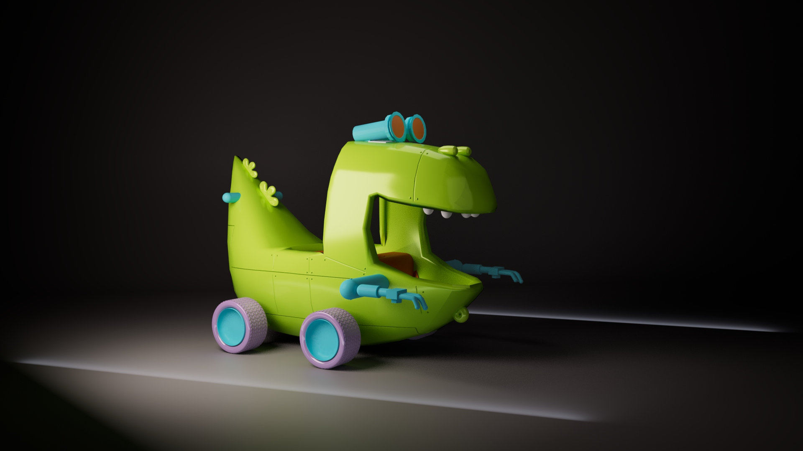
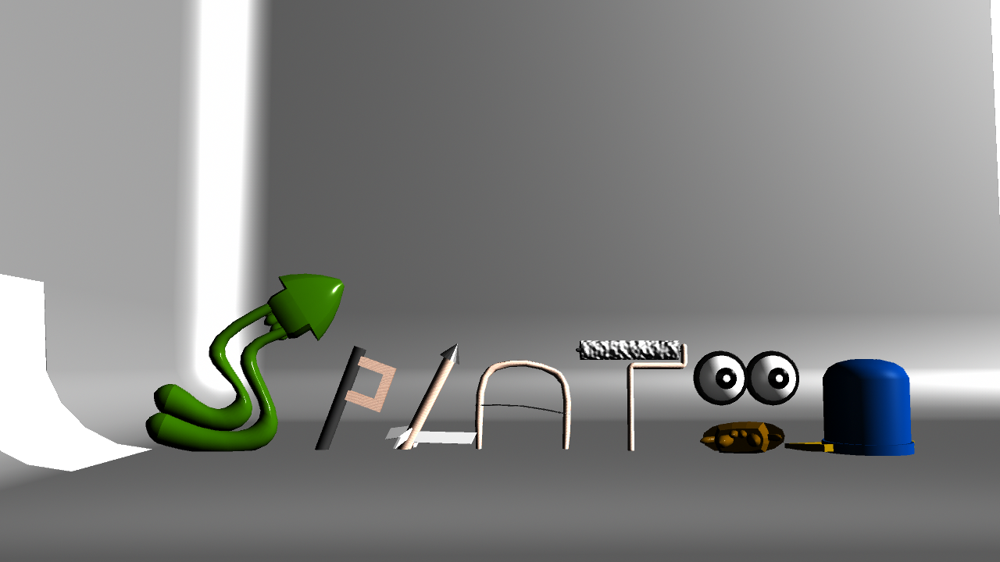
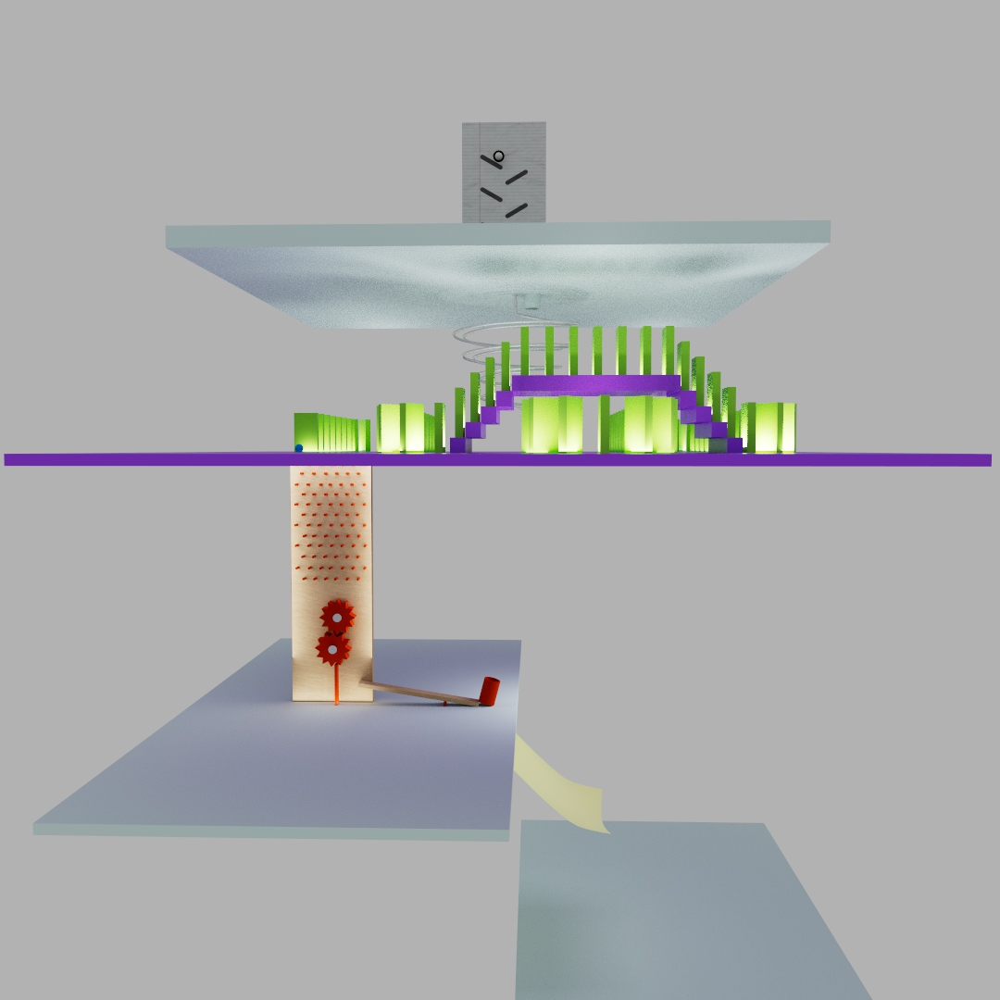

# 3D Coursework Showcase

Selected renders and animation clips from my Maya coursework. This public repository is a visual portfolio; Maya scenes, texture projects, reports, and source/reference photographs are kept out of this showcase.

## Car Modeling and Texturing

A course project exploring a stylized vehicle model and its rendered presentation.

## Splatoon Animation

A stylized Maya animation coursework project inspired by Splatoon.

[Watch the animation](02-Splatoon-Animation/splatoon-animation.mp4)

## Character Animation

A later animation exercise presented with a representative frame and the final animation clip.

[Watch the animation](03-Character-Animation/character-animation.mp4)
