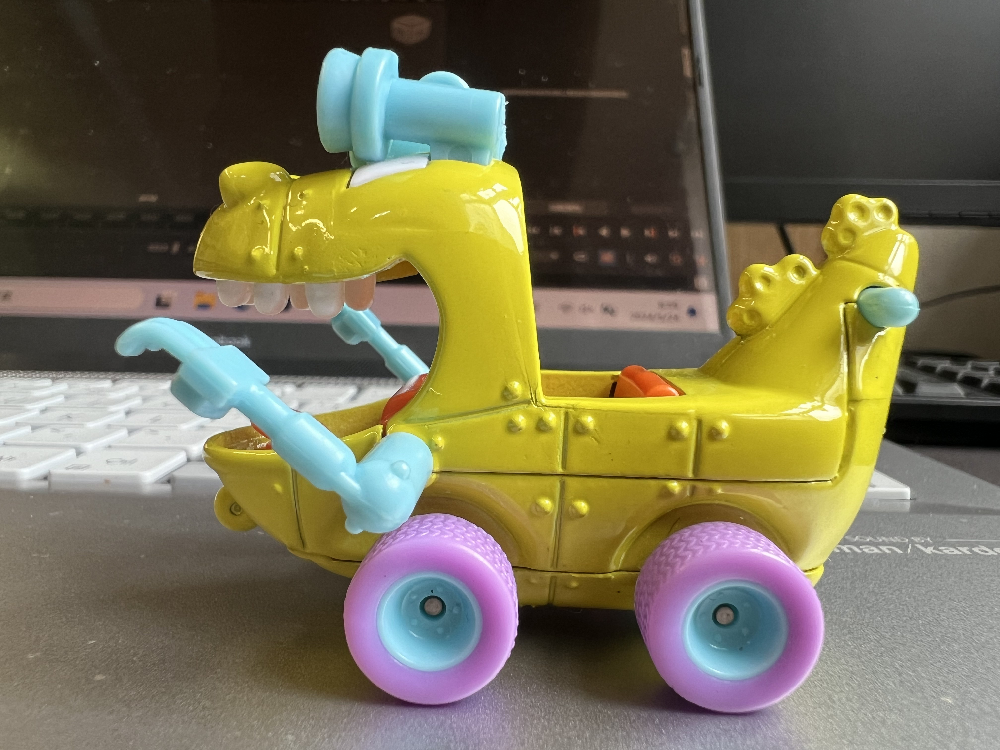
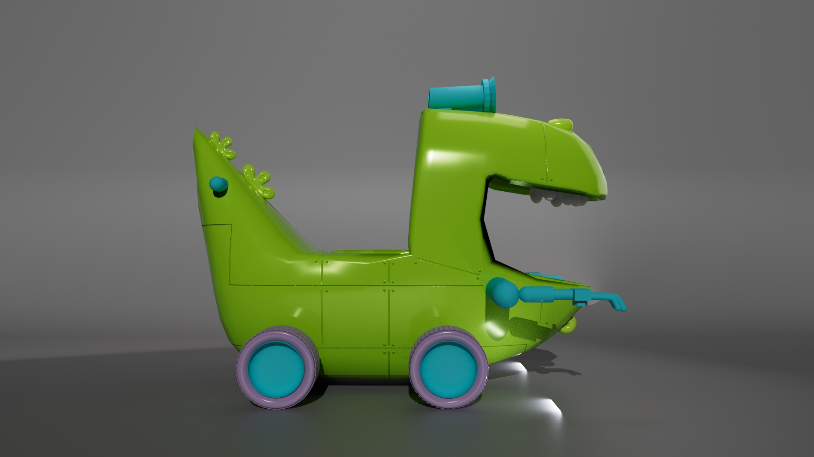

# 3D Coursework Showcase

Selected renders and animation clips from my Maya coursework. This public repository is a visual portfolio. Maya scenes, texture projects, reports, and other source files are kept out of this showcase; one selected reference photo is included for the modeling comparison.

## Car Modeling and Texturing

Modeled a stylized Reptar wagon from a physical toy reference. The car body was built from polygon geometry, refined with loop cuts and smoothing, and prepared for UV texturing. In Substance Painter, I painted the body grooves and rivets; I then brought the textured model back into Maya and developed several lighting setups for different moods and detail shots.

**Techniques:** polygon modeling, topology refinement, smoothing, UV unwrapping, Substance Painter texturing, Arnold lighting and rendering.

### Reference and 3D result

| Physical reference | Maya render |
| --- | --- |
|  |  |

## Splatoon Animation

An animated Splatoon-themed alphabet: the letter S becomes a squid with tentacles, while OO forms a pair of cartoon eyes. The remaining letters turn into in-game objects such as a gun, bow and arrow, brush, and bucket. The squid tentacles use bone rigs for bending and stretching, with flare deformation added for the swimming motion; the running squid uses basic bones and leg IK. The report discusses animation principles including arcs and anticipation, and notes areas for further polish such as slow-in/slow-out and squash-and-stretch.

**Techniques:** character modeling, bone rigging, IK, tentacle deformation, keyframe animation, motion principles.

[Watch the animation](02-Splatoon-Animation/splatoon-animation.mp4)

## Rube Goldberg Machine

A four-floor Rube Goldberg machine built around a toon-shaded first floor, springboards, dominoes and spiral slide, gears and levers, then cloth and particle effects. Domino motion uses dynamic rigid bodies; the spiral slide was made with Curve Warp; the final stage combines Bullet rigid-body and soft-body simulations with NParticle effects.

**Techniques:** aiToon shading, dynamic rigid-body simulation, Bullet soft bodies, NParticles, Curve Warp, simulation troubleshooting.

[Watch the animation](03-Character-Animation/character-animation.mp4)

